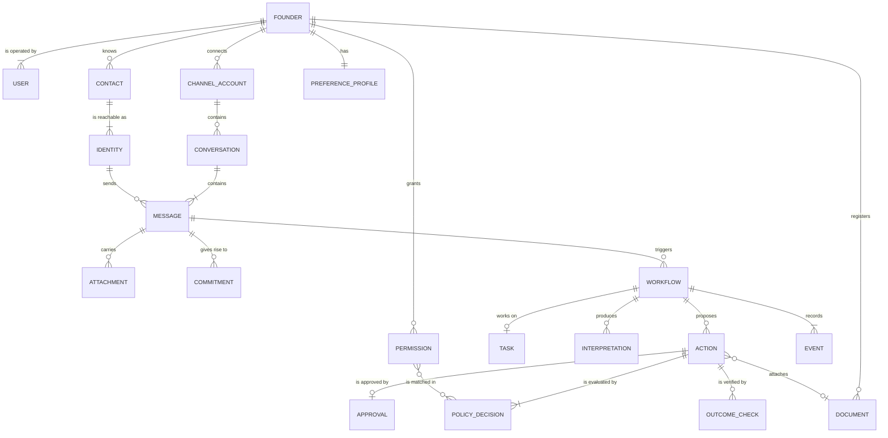

# Axon — Domain Model

Entities, their key fields, how they relate and how they change over time. Table definitions for the first workflow are in the [workflow LLD](workflows/investor-document-request.md#5-tables). Rules that constrain these entities are in [`invariants.md`](invariants.md).

Every entity except Founder carries `founder_id`. It is omitted from the field lists below.

## 1. Relations



## 2. Entities

### Founder

The tenant. All data belongs to exactly one Founder.

Key fields: `id`, `display_name`, `timezone`, `created_at`, `deleted_at`.

### User

A login that can act for a Founder. The blueprint lists Founder and User separately so that assistants or co-founders can be added later.

Key fields: `id`, `email`, `role`.

Lifecycle: in the MVP each Founder has one User with role `owner`. Only an `owner` can approve Actions and edit Permissions.

### Channel and Channel Account

A Channel is a platform type: `gmail`, later `whatsapp`, `slack` and others. A Channel Account is one founder-owned account on a Channel that Axon is connected to.

Key fields (Channel Account): `id`, `channel`, `address`, `credentials` (encrypted), `sync_cursor`, `status` (`connected`, `needs_reauth`, `disconnected`).

Lifecycle: created when the founder completes OAuth. Moves to `needs_reauth` when the provider rejects the credentials. Ingestion and execution stop for an account that is not `connected`.

### Contact

A person or organisation the Founder communicates with.

Key fields: `id`, `display_name`, `relationship` (`investor`, `customer`, `employee`, `cofounder`, `partner`, `vendor`, `other`), `organisation`, `notes`.

Lifecycle: created and edited by the founder in the MVP. A sender with no matching Identity has no Contact; Axon does not create one automatically.

### Identity

A Contact's handle on one Channel, for example an email address.

Key fields: `id`, `contact_id`, `channel`, `handle` (normalised), `confirmed_by_founder`.

One Contact has many Identities. A handle on a Channel belongs to at most one Contact per Founder. Whether a given message really came from the handle is a property of the Message (`sender_verified`), not of the Identity.

### Conversation

A thread of Messages on one Channel Account. For Gmail it corresponds to a thread.

Key fields: `id`, `channel_account_id`, `provider_conversation_id`, `subject`, `participants`, `status` (`open`, `awaiting_reply`, `replied`, `bounced`, `closed`), `last_message_at`.

Lifecycle: created with its first Message. Status is maintained by Outcome Tracking.

### Message

One normalised communication item.

Key fields: `id`, `conversation_id`, `provider_message_id`, `direction` (`inbound`, `outbound`), `sender_identity_id` (nullable), `sender_handle`, `sender_verified`, `recipients`, `sent_at`, `body_ref`, `raw_ref`, `origin` (`external`, `founder`, `axon`).

A Message from a sender with no matching Identity is kept as metadata only and has no body.

Lifecycle: immutable after normalisation. `body_ref` and `raw_ref` are cleared when retention expires; the row and its metadata remain until the Conversation or Founder is deleted.

### Attachment

A file carried by a Message.

Key fields: `id`, `message_id`, `filename`, `media_type`, `size`, `content_hash`, `blob_ref`.

Inbound attachment content is fetched only when a workflow needs it.

### Document

A file the Founder has registered with Axon, such as the financial projections.

Key fields: `id`, `title`, `kind` (for example `financial_projections`), `version`, `content_hash`, `blob_ref`, `sharing` (`shareable`, `never_share`), `status` (`active`, `archived`).

The set of a Founder's Documents is what the PRD calls the library. A `never_share` Document is blocked for every Contact.

Lifecycle: uploading a new file creates a new version. Permissions refer to a Document or a `kind`. An Action records the exact version and hash it attaches.

### Commitment

A promise made in a Conversation, by the Founder or by a Contact, with an optional due date.

Key fields: `id`, `source_message_id`, `made_by` (`founder` or a `contact_id`), `made_to`, `statement`, `due_at`, `status` (`open`, `fulfilled`, `broken`, `withdrawn`).

Lifecycle: the entity is defined now; extraction is deferred past the MVP. When built, a Commitment made by the Founder creates a Task.

### Task

A unit of pending work that Axon or the Founder owes, derived from a request or a Commitment. Example: "send financial projections to this investor".

Key fields: `id`, `kind` (`document_request`, `follow_up`), `contact_id`, `source_message_id`, `commitment_id` (nullable), `owner` (`axon`, `founder`), `due_at`, `status` (`open`, `done`, `dropped`).

Lifecycle: opened when a Workflow reaches `UNDERSTOOD`. Closed as `done` when the Workflow reaches `COMPLETED`, and as `dropped` when it ends in `REJECTED`, `BLOCKED` or `CANCELLED`. It stays `open` on `FAILED` so the founder still sees it.

### Workflow

One running instance of a workflow type, triggered by a Message. The type defines the allowed states and transitions.

Key fields: `id`, `type` (`investor_document_request`; null until interpreted), `state`, `trigger_message_id`, `conversation_id`, `contact_id`, `task_id`, `trace_id`, `state_entered_at`, `deadline_at`, `escalation_reason`.

Lifecycle: states and transitions are defined in the [workflow document](workflows/investor-document-request.md). At most one non-terminal Workflow exists per Conversation.

### Interpretation

Intelligence output for one Message in one Workflow.

Key fields: `id`, `workflow_id`, `message_id`, `intent`, `requested_item`, `document_id` (nullable), `urgency`, `risks`, `confidence`, `confirmed_by_founder`, `model_id`, `prompt_version`, `context_item_ids`.

Lifecycle: immutable. Reprocessing creates a new Interpretation and marks the previous one superseded.

### Action

One operation on a Channel, from proposal to verified result. It covers the proposal, the command and the execution record of the same operation.

Key fields: `id`, `workflow_id`, `type` (`send_email_reply`), `channel_account_id`, `recipient_identity_id`, `recipient_handle`, `body_ref`, `document_id`, `document_hash`, `content_hash`, `status`, `idempotency_key`, `attempts`, `external_ref`, `last_error_class`.

Status lifecycle:

```text
PROPOSED → AUTHORISED → EXECUTING → SUCCEEDED
    │           │            ├────→ FAILED
    │           │            └────→ OUTCOME_UNKNOWN → SUCCEEDED | FAILED   (after reconcile)
    └───────────┴────→ CANCELLED
```

`content_hash` covers recipient, body and attachment hash. An Action in `PROPOSED` is a proposal. It becomes a command when it is `AUTHORISED`, which requires an auto-execute Policy Decision or an Approval for the same `content_hash`.

### Permission

A founder-granted rule that sets the autonomy tier for a class of Actions.

Key fields: `id`, `action_type`, `relationship` (nullable), `contact_id` (nullable), `document_id` or `document_kind` (nullable), `tier` (`auto_execute`, `approval_required`, `blocked`), `status` (`active`, `revoked`), `created_by_user_id`.

Lifecycle: created, edited and revoked by an `owner` User. Edits create a new row and revoke the old one, so a Policy Decision always points at the exact rule text it matched.

### Policy Decision

The policy gate's result for one Action at one point in time.

Key fields: `id`, `action_id`, `content_hash`, `tier`, `reason_codes`, `matched_permission_ids`, `policy_version`, `facts` (the inputs used), `decided_at`.

Lifecycle: immutable. An Action may have several, one per evaluation; the latest governs.

### Approval

A founder decision on one Action.

Key fields: `id`, `action_id`, `content_hash`, `decision` (`approved`, `rejected`), `decided_by_user_id`, `reason`, `decided_at`.

Lifecycle: immutable. Valid only while the Action's `content_hash` equals the Approval's.

### Outcome Check

One verification attempt for an executed Action.

Key fields: `id`, `action_id`, `kind` (`sent_present`, `bounce`), `result` (`pass`, `fail`, `inconclusive`), `observed`, `checked_at`.

### Preference Profile

Founder Intelligence's record for one Founder.

Key fields: `tone`, `length`, `sign_off`, `language`, plus a list of feedback signals (`action_id`, `signal`, `detail`).

### Event

An immutable fact about what happened.

Key fields: `id`, `type`, `schema_version`, `workflow_id`, `trace_id`, `actor` (`system`, a `user_id`, or a layer name), `subject_refs`, `payload`, `occurred_at`.

Events hold IDs and references. They do not hold message bodies, attachment content or credentials.

## 3. Mapping to observation, proposal, command and event

| Kind | Entities |
| --- | --- |
| Observation | Message, Attachment, Outcome Check |
| Proposal | Interpretation, Action in `PROPOSED` |
| Command | Action in `AUTHORISED` or later, with its Policy Decision or Approval |
| Event | Event |

## 4. Assumptions and open questions

Assumptions:

1. `Workflow` means a running instance. The definition of a workflow type lives in code and in its workflow document.
2. `Document`, `Interpretation`, `Policy Decision`, `Approval`, `Outcome Check` and `Preference Profile` are added to the blueprint's entity list because the first workflow cannot be specified without them.
3. Contacts are founder-maintained in the MVP. Axon does not create or merge them.
4. An Identity belongs to one Contact. Shared mailboxes (for example `team@fund.com`) are modelled as a Contact for the organisation.
5. Commitment is defined but not populated in the MVP.

Open questions are collected in [`open-questions.md`](open-questions.md).
