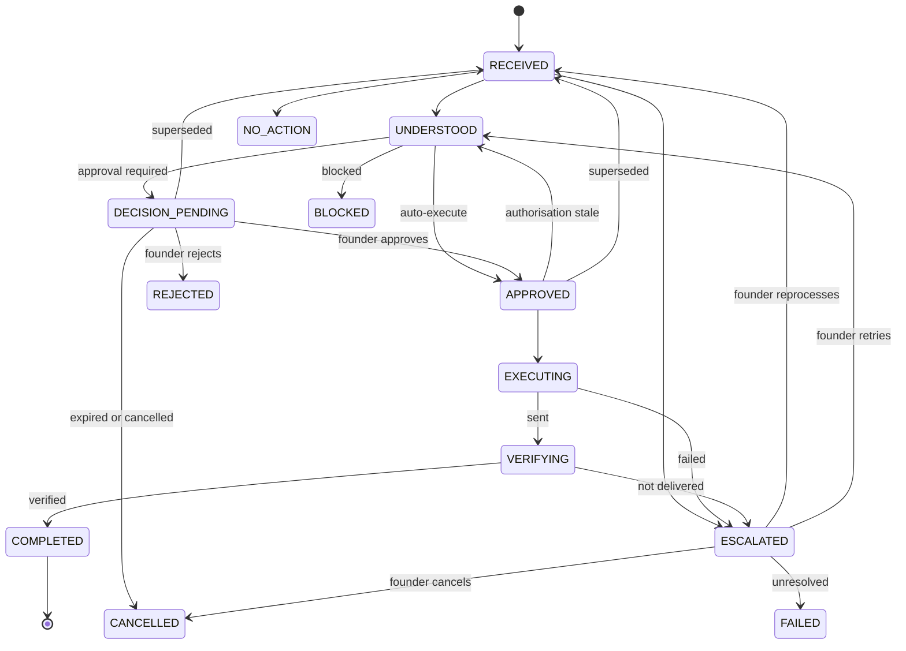

# Workflow: Investor Document Request

State machine and low-level design for the first workflow: an investor emails the founder asking for financial projections, and Axon replies with the document when authorised.

Scope and acceptance criteria are in [`../prd.md`](../prd.md). Layer responsibilities are in [`../architecture.md`](../architecture.md). Entities are in [`../domain-model.md`](../domain-model.md). The state names in this document are canonical for all other documents.

## 1. States

| State | Meaning | Terminal |
| --- | --- | --- |
| `RECEIVED` | An inbound Message is stored and a Workflow exists for it. | No |
| `UNDERSTOOD` | Sender resolved, context retrieved, Message interpreted, an Action proposed. | No |
| `DECISION_PENDING` | Policy requires founder approval. Waiting for the founder. | No |
| `APPROVED` | The Action is authorised, by policy or by the founder. Waiting for execution. | No |
| `EXECUTING` | Execution is sending the reply. | No |
| `VERIFYING` | The send returned. Outcome Tracking is confirming it. | No |
| `ESCALATED` | Axon cannot proceed without the founder. Carries a reason. | No |
| `COMPLETED` | The reply was sent and verified. | Yes |
| `NO_ACTION` | The Message is not a request this workflow handles. | Yes |
| `REJECTED` | The founder declined the proposed Action. | Yes |
| `BLOCKED` | Policy forbids the Action. | Yes |
| `CANCELLED` | The founder cancelled or replied themselves, the Channel Account was disconnected, or an approval request expired. | Yes |
| `FAILED` | An escalation was not resolved in time. | Yes |



Cancellation edges from `RECEIVED`, `UNDERSTOOD` and `APPROVED` are omitted from the diagram and listed in the table below.

## 2. Transitions

| # | From | To | Trigger | Guard |
| --- | --- | --- | --- | --- |
| T1 | (none) | `RECEIVED` | `message.ingested` consumed by Orchestration | Message is inbound, not automated mail, its sender resolves to a Contact, and the Conversation has no active Workflow. A Message from an unknown sender starts no Workflow (see [section 3](#3-steps-by-layer)). |
| T2 | `RECEIVED` | `UNDERSTOOD` | Orchestration job `understand` finishes | Intent is `document_request`, confidence at or above the interpretation floor, exactly one registered Document resolved, Action built. |
| T3 | `RECEIVED` | `NO_ACTION` | `understand` finishes | Intent is anything else, with confidence at or above the floor. |
| T4 | `RECEIVED` | `ESCALATED` | `understand` finishes or exhausts retries | Confidence below the floor (`ambiguous_request`); no or several candidate Documents (`missing_document`, `ambiguous_document`); model returned an invalid Document ID (`invalid_document`); model or schema failure after retries (`understanding_failed`). |
| T5 | `UNDERSTOOD` | `APPROVED` | Policy gate returns `auto_execute` | All conditions of [INV-8](../invariants.md) hold. Action becomes `AUTHORISED`. |
| T6 | `UNDERSTOOD` | `DECISION_PENDING` | Policy gate returns `approval_required` | Approval request created and shown in the founder inbox. A notification email with no message content is sent to the founder. |
| T7 | `UNDERSTOOD` | `BLOCKED` | Policy gate returns `blocked` | None. The founder inbox shows the block and its reason. |
| T8 | `DECISION_PENDING` | `APPROVED` | Founder approves in the web app | User is an `owner`. Approval `content_hash` equals the Action's. Policy gate re-run does not return `blocked`. |
| T9 | `DECISION_PENDING` | `REJECTED` | Founder rejects | User is an `owner`. |
| T10 | `DECISION_PENDING` | `CANCELLED` | Timer: approval expiry | No decision after 7 days. Reason `approval_expired`. |
| T11 | `APPROVED` | `EXECUTING` | Worker picks up job `execute` | `check_authorisation` passes. Channel Account is `connected`. |
| T12 | `APPROVED` | `UNDERSTOOD` | Worker picks up job `execute` | `check_authorisation` fails: Permission revoked, Document version changed, or hash mismatch. Policy is evaluated again. |
| T13 | `EXECUTING` | `VERIFYING` | Connector returns a sent-message reference, or reconciliation finds one | Action is `SUCCEEDED` with `external_ref`. |
| T14 | `EXECUTING` | `ESCALATED` | Execution gives up | Retryable errors exhausted (`execution_failed`); non-retryable error (`channel_auth_failed`, `channel_rejected`); reconciliation inconclusive (`outcome_unknown`). |
| T15 | `VERIFYING` | `COMPLETED` | Outcome Tracking job `verify` | Sent message present in the thread with the expected recipient and attachment hash, and no bounce by the end of the bounce window. |
| T16 | `VERIFYING` | `ESCALATED` | `verify` | Bounce detected or sent message does not match (`delivery_failed`); verification could not run for 24 hours (`verification_unavailable`). |
| T17 | `ESCALATED` | `RECEIVED` | Founder chooses "reprocess" | Used after the founder fixes inputs, for example registers the missing Document. Previous Interpretation and Action are superseded. |
| T18 | `ESCALATED` | `UNDERSTOOD` | Founder chooses "retry" | Available for execution and channel reasons. Action is unsent (`FAILED`, not `SUCCEEDED` or `OUTCOME_UNKNOWN`). A new Action is created from the same content and policy is evaluated again. |
| T19 | `ESCALATED` | `CANCELLED` | Founder dismisses | None. |
| T20 | `ESCALATED` | `FAILED` | Timer: escalation expiry | Unresolved after 14 days. |
| T21 | `UNDERSTOOD`, `DECISION_PENDING`, `APPROVED` | `RECEIVED` | New inbound Message in the same Conversation | Supersede: the new Message becomes the trigger. Interpretation, Action and any Approval are superseded. |
| T22 | `RECEIVED`, `UNDERSTOOD`, `DECISION_PENDING`, `APPROVED` | `CANCELLED` | Founder cancels, founder replies in the thread themselves, or founder disconnects the Channel Account | Nothing has been sent. Proposed or authorised Action becomes `CANCELLED`. |
| T23 | `ESCALATED` | `UNDERSTOOD` | Founder confirms the request and selects the Document | Reason is `ambiguous_request` or `ambiguous_document`. A new Interpretation is stored with the founder's choice and marked `confirmed_by_founder`, which satisfies the confidence condition. Action built; policy is evaluated as usual. |

Notes on specific paths:

- **Timeouts.** `DECISION_PENDING` sends reminders at 24 and 72 hours and expires at 7 days (T10). `ESCALATED` expires at 14 days (T20). `RECEIVED`, `UNDERSTOOD`, `APPROVED`, `EXECUTING` and `VERIFYING` each have a processing deadline; a Workflow past its deadline raises an alert and the job is retried.
- **Retries.** Retries inside `RECEIVED`, `EXECUTING` and `VERIFYING` do not change state. Each attempt is recorded as an event. Limits are in [section 10](#10-error-handling).
- **Cancellation after sending starts.** Once the send call has been issued, the Workflow cannot be cancelled. In `EXECUTING` before the send call, cancellation deletes the Gmail draft and moves the Action to `CANCELLED`. `VERIFYING` cannot be cancelled; the outcome is recorded.
- **New Message during `EXECUTING` or `VERIFYING`.** The Message is stored. A new Workflow for it starts when the current one reaches a terminal state or `ESCALATED`.
- **Founder replies manually.** An outbound Message from the founder in the Conversation while the Workflow is before `EXECUTING` triggers T22 with reason `founder_replied`.
- **Escalation.** The only escalation target in the MVP is the founder. Every escalation carries a reason code, the evidence, and the available resolutions, and sends the founder a notification email with no message content.
- **Blocked.** A `BLOCKED` Workflow is shown in the founder inbox with the Permission or Document setting that blocked it. No notification email is sent.

## 3. Steps by layer

| Step | Layer | State during | Output |
| --- | --- | --- | --- |
| 1 | Integration | (before Workflow) | Raw Gmail message fetched via history polling |
| 2 | Data Normalisation | (before Workflow) | Message, Conversation, Attachment metadata |
| 3 | Data Storage | (before Workflow) | Rows written; `message.ingested` |
| 4 | Decision & Orchestration | → `RECEIVED` | Workflow created, if the sender resolved to a Contact |
| 5 | Identity & Relationships | (before Workflow) | Contact, relationship, `sender_verified`; or no match |
| 6 | Context & Memory | `RECEIVED` | Context bundle |
| 7 | Founder Intelligence | `RECEIVED` | Preference profile |
| 8 | Intelligence | `RECEIVED` | Interpretation and draft |
| 9 | Decision & Orchestration | → `UNDERSTOOD` | Task and proposed Action |
| 10 | Policy gate | `UNDERSTOOD` | Policy Decision → `APPROVED`, `DECISION_PENDING` or `BLOCKED` |
| 11 | Founder (web app) | `DECISION_PENDING` | Approval |
| 12 | Execution | `APPROVED` → `EXECUTING` | Reply sent through Integration |
| 13 | Outcome Tracking | `VERIFYING` | Outcome Checks → `COMPLETED` or `ESCALATED` |
| 14 | Founder Intelligence | after founder decision | Feedback signal recorded |

Identity resolution runs when a Message is ingested, before T1. A Message whose sender matches no Identity is kept as metadata only (provider message ID, sender address, time; see NFR-3 in the [PRD](../prd.md)), is not interpreted, and is listed in the founder inbox as an unknown-sender item with no notification email. When the founder adds the sender as a Contact or attaches the address to an existing Contact, Integration fetches the Message again and T1 applies.

## 4. Policy evaluation for this workflow

Facts passed to the policy gate:

| Fact | Source |
| --- | --- |
| `action_type` = `send_email_reply` | Action |
| `contact_id`, `relationship` | Identity & Relationships |
| `sender_verified` | Message (from Gmail authentication headers) |
| `reply_to_matches_identity` | Normalisation: `Reply-To` absent or equal to the sender address |
| `document_id`, `document_kind`, `document_sharing` | Action, Document |
| `interpretation_confidence`, `confirmed_by_founder` | Interpretation |
| `content_risk` | Interpretation: true when it reports instructions addressed to Axon inside the Message |
| `already_sent_same_version` | Context: a `SUCCEEDED` Action to this Contact with the same Document hash |

Resolution:

1. If the Document is marked `never_share`, the tier is `blocked` with reason `document_never_share`. Stop.
2. Collect active Permissions that match the action type, the Contact or its relationship, and the Document or its kind.
3. If any match names the Contact, tier = most restrictive among those. Otherwise tier = most restrictive among the matches on relationship. No match gives `approval_required`. ([INV-7](../invariants.md))
4. If the tier is `auto_execute` and any INV-8 condition fails, downgrade to `approval_required` and add the reason code (`unknown_contact`, `sender_unverified`, `reply_to_mismatch`, `low_confidence`, `content_risk`).
5. Record the Policy Decision with matched Permission IDs and reason codes.

`content_risk` and `interpretation_confidence` come from model output. They can only make the tier more restrictive.

`already_sent_same_version` does not change the tier. It is shown to the founder and passed to drafting.

## 5. Tables

Every table has `founder_id` and row-level security. Columns are listed where they matter to this workflow; entity definitions are in the [domain model](../domain-model.md).

| Table | Owning layer | Key columns and constraints |
| --- | --- | --- |
| `founders`, `users` | Storage | `users.role` |
| `channel_accounts` | Integration | `channel`, `address`, `credentials_enc`, `sync_cursor`, `status` |
| `raw_items` | Integration | `channel_account_id`, `provider_message_id`, `blob_ref`, `expires_at`; unique `(channel_account_id, provider_message_id)` |
| `conversations` | Normalisation (status: Outcome Tracking) | `provider_conversation_id`, `status`; unique `(channel_account_id, provider_conversation_id)` |
| `messages` | Normalisation | `provider_message_id`, `direction`, `origin`, `sender_handle`, `sender_identity_id`, `sender_verified`, `reply_to`, `rfc822_message_id`, `body_ref`, `raw_item_id`; unique `(channel_account_id, provider_message_id)` |
| `attachments` | Normalisation | `message_id`, `content_hash`, `blob_ref` |
| `contacts`, `identities` | Identity & Relationships | unique `(founder_id, channel, handle)` on `identities` |
| `documents` | Storage | `kind`, `version`, `content_hash`, `blob_ref`, `sharing`, `status` |
| `preference_profiles`, `feedback_signals` | Founder Intelligence | one profile per Founder |
| `permissions` | Governance | `action_type`, `relationship`, `contact_id`, `document_id`, `document_kind`, `tier`, `status` |
| `workflows` | Orchestration | `type`, `state`, `trigger_message_id`, `conversation_id`, `trace_id`, `deadline_at`, `escalation_reason`; partial unique index on `conversation_id` for non-terminal states |
| `tasks` | Orchestration | `kind`, `contact_id`, `status` |
| `interpretations` | Orchestration (content from Intelligence) | `workflow_id`, `message_id`, `intent`, `confidence`, `document_id`, `model_id`, `prompt_version`, `confirmed_by_founder`, `superseded` |
| `actions` | Orchestration (execution fields: Execution) | `workflow_id`, `type`, `recipient_handle`, `body_ref`, `document_id`, `document_hash`, `content_hash`, `status`, `idempotency_key` unique, `draft_ref`, `external_ref`, `attempts`, `last_error_class`; check `external_ref is not null` when `status = 'SUCCEEDED'` |
| `policy_decisions` | Governance | `action_id`, `content_hash`, `tier`, `reason_codes`, `matched_permission_ids`, `policy_version`, `facts` |
| `approvals` | Governance | `action_id`, `content_hash`, `decision`, `decided_by_user_id`; unique `(action_id, content_hash)` |
| `outcome_checks` | Outcome Tracking | `action_id`, `kind`, `result`, `observed` |
| `events` | Storage | append-only; see [section 7](#7-events) |
| `jobs` | Storage | `kind`, `workflow_id`, `run_at`, `attempts`, `locked_until`, `dedupe_key` unique |

## 6. Internal interfaces

Signatures are indicative. Request and result types are immutable data classes.

```python
# Layer 1
class Connector(Protocol):
    def fetch_changes(self, account: ChannelAccount, cursor: str | None) -> ChangeBatch: ...
    def validate(self, command: SendReplyCommand) -> None: ...
    def execute(self, command: SendReplyCommand, idempotency_key: str) -> ExecutionResult: ...
    def observe(self, account: ChannelAccount, external_ref: str) -> ExternalState: ...
    def reconcile(self, command: SendReplyCommand) -> ReconcileResult: ...

# Layer 2
def normalise(raw: RawItem) -> NormalisedItem: ...

# Layer 4
def resolve_sender(founder_id, channel: str, handle: str, auth: SenderAuth) -> IdentityMatch: ...

# Layer 5
def retrieve_context(founder_id, message_id, contact_id: UUID | None) -> ContextBundle: ...

# Layer 6
def interpret(message: MessageView, context: ContextBundle, documents: list[DocumentRef]) -> InterpretationResult: ...
def draft_reply(message: MessageView, context: ContextBundle, interpretation: InterpretationResult,
                preferences: Preferences) -> DraftResult: ...

# Layer 10
def get_preferences(founder_id) -> Preferences: ...
def record_feedback(founder_id, action_id, signal: FeedbackSignal) -> None: ...

# Governance
def evaluate(action: ProposedAction, facts: PolicyFacts) -> PolicyDecision: ...
def check_authorisation(action_id) -> AuthorisationCheck: ...

# Layer 8
def execute_action(action_id) -> ExecutionResult: ...

# Layer 9
def verify_action(action_id) -> list[OutcomeCheck]: ...

# Layer 7
def transition(workflow_id, to_state: State, trigger: str, **details) -> None: ...
```

`ExecutionResult` is one of `Succeeded(external_ref)`, `Retryable(error_class)`, `NonRetryable(error_class)`, `Unknown`. `ReconcileResult` is one of `Sent(external_ref)`, `NotSent`, `Inconclusive`.

HTTP endpoints used by the web app for this workflow:

| Method and path | Purpose |
| --- | --- |
| `GET /v1/inbox` | Workflows in `DECISION_PENDING` and `ESCALATED`, recent `BLOCKED` and `CANCELLED` (expired), and unknown-sender items |
| `GET /v1/workflows/{id}` | State, Message, Interpretation, Action, Policy Decision, timeline |
| `POST /v1/actions/{id}/approval` | Body: `decision`, `content_hash`, optional `edited_body`, optional `reason` |
| `POST /v1/workflows/{id}/cancel` | Cancel (T22, T19) |
| `POST /v1/workflows/{id}/reprocess`, `/retry`, `/confirm` | Resolve an escalation (T17, T18, T23) |

An approval with `edited_body` updates the Action body, recomputes `content_hash`, records the edit as a feedback signal, and stores the Approval against the new hash. The founder cannot edit the recipient. The founder may switch the attachment to another registered Document version, which re-runs the policy gate before the Approval is accepted.

## 7. Events

Envelope:

| Field | Description |
| --- | --- |
| `id` | Unique event ID |
| `type`, `schema_version` | Event type and its version |
| `founder_id`, `workflow_id`, `trace_id` | Scope and correlation |
| `actor` | Layer name, `policy_gate`, or a User ID |
| `subject_refs` | IDs of the Message, Action, and other records concerned |
| `payload` | Type-specific fields. IDs, codes and counts only. |
| `occurred_at` | Timestamp |

Types emitted by this workflow:

| Type | Emitted by | When |
| --- | --- | --- |
| `message.ingested` | Storage | A new Message row is inserted |
| `workflow.state_changed` | Orchestration | Every transition; payload has `from`, `to`, `transition`, `reason` |
| `identity.resolved` | Identity & Relationships | Step 5 |
| `context.retrieved` | Context & Memory | Step 6; payload has item IDs |
| `message.interpreted` | Orchestration | Interpretation stored |
| `interpretation.failed` | Orchestration | Model or schema failure; payload has attempt and error class |
| `action.proposed` | Orchestration | Action created |
| `policy.evaluated` | Policy gate | Each evaluation |
| `approval.requested`, `approval.reminded` | Orchestration | T6 and reminder timers |
| `founder.notified` | Orchestration | A notification or reminder email was handed to the mail provider |
| `approval.recorded` | Governance | Founder decision |
| `action.authorised` | Governance | Action becomes `AUTHORISED` |
| `action.execution_attempted` | Execution | Each attempt; payload has attempt number |
| `action.succeeded`, `action.failed`, `action.outcome_unknown` | Execution | Result of an attempt or reconciliation |
| `action.cancelled` | Orchestration | T21, T22 |
| `outcome.checked` | Outcome Tracking | Each Outcome Check |
| `workflow.escalated` | Orchestration | Entering `ESCALATED`; payload has reason code |
| `feedback.recorded` | Founder Intelligence | After a founder decision |

Events are written in the same transaction as the state they describe. Jobs for the next step are inserted in that transaction too, so a step is neither lost nor run without its state.

## 8. Gmail interactions

These are the calls the design depends on. Confirmation that they behave as assumed belongs in [`../feasibility.md`](../feasibility.md).

| Purpose | Call | Notes |
| --- | --- | --- |
| Connect | OAuth with `gmail.readonly` and `gmail.compose` | Read mail; create and send drafts. No delete or modify scope. The verification tier of `gmail.compose` is not yet confirmed ([ADR 0005](../adr/0005-gmail-draft-then-send.md)). |
| Initial cursor | `users.getProfile` | Store `historyId` as `sync_cursor`. No backfill of old mail in the MVP beyond the threads the workflow touches. |
| Ingest | `users.history.list` from `sync_cursor`, polled every 60 seconds. Push through `users.watch` is deferred; history polling is the fallback Google recommends in any case. | On `404` (cursor too old), resync from `users.messages.list` for the last 7 days, then continue. |
| Fetch message | `users.messages.get` with `format=raw` | Raw item stored, then normalised. |
| Fetch thread | `users.threads.get` | For context and for verification. |
| Create reply | `users.drafts.create` with `threadId`, `In-Reply-To` and `References` headers, attachment as MIME part | Returned draft ID stored on the Action as `draft_ref` before sending. |
| Send | `users.drafts.send` | Returned message ID stored as `external_ref`. |
| Verify | `users.messages.get` on `external_ref`; `users.threads.get` | Check `SENT` label, recipient, attachment hash. Look for a delivery-failure message in the thread. |
| Cancel before send | `users.drafts.delete` | Only while the Action is `EXECUTING` and the send call has not been issued. |

Normalisation details specific to Gmail:

- `sender_verified` is true when the `Authentication-Results` header added by Gmail reports a DMARC pass for the `From` domain.
- A message is treated as automated, and starts no Workflow, when it has `Auto-Submitted` other than `no`, a `List-Unsubscribe` header, or a `mailer-daemon` or `postmaster` sender. Bounce messages are still passed to Outcome Tracking.
- For a Message whose sender matches no Identity, the raw item and body are discarded after sender resolution and only metadata is kept.
- Messages sent by Axon are recognised by matching `external_ref` and stored with `origin = axon`. Other messages from the founder's address have `origin = founder`.

## 9. Idempotency

| Stage | Mechanism |
| --- | --- |
| Ingestion | Unique `(channel_account_id, provider_message_id)`; insert-or-ignore. Re-polling the same history range is harmless. |
| Workflow creation | Partial unique index on `conversation_id` for active Workflows; `jobs.dedupe_key` = `understand:{message_id}`. |
| Jobs | The worker claims a job with `FOR UPDATE SKIP LOCKED` and a lease. Every job handler first checks that the Workflow is in the state the job expects and exits otherwise. |
| Approval | Unique `(action_id, content_hash)`. A repeated approve request returns the existing Approval. |
| Send | `idempotency_key` = Action ID. Execution proceeds in recorded steps: (a) create draft, store `draft_ref`; (b) send draft, store `external_ref`. On restart it resumes from the last stored step. |
| Unknown outcome | If step (b) times out or the process dies after issuing it, the Action becomes `OUTCOME_UNKNOWN`. `reconcile` checks whether the draft still exists and whether the thread contains a `SENT` message created after step (a) with the same recipient and attachment hash. `Sent` → `SUCCEEDED`. `NotSent` (draft still present) → send again. `Inconclusive` → `ESCALATED` with `outcome_unknown`; Axon does not resend. |

## 10. Error handling

| Failure | Class | Handling |
| --- | --- | --- |
| Gmail `429`, `5xx`, network error on read | Retryable | Exponential backoff with jitter. Ingestion keeps its cursor and tries again next poll. |
| Gmail `429`, `5xx`, network error before the send call | Retryable | Up to 5 attempts over about 30 minutes, then T14 `execution_failed`. |
| Timeout or connection loss on the send call | Unknown | Reconcile before any further attempt (section 9). |
| Gmail `401` / `invalid_grant` | Non-retryable | Channel Account → `needs_reauth`. Active Workflow → `ESCALATED` with `channel_auth_failed`. Ingestion pauses. |
| Gmail `400`, `403` on send | Non-retryable | T14 `channel_rejected`. |
| Attachment exceeds Gmail's size limit | Non-retryable | Detected by `validate` before `EXECUTING`; `ESCALATED` with `channel_rejected`. |
| LLM timeout, `5xx`, rate limit | Retryable | Up to 3 attempts, then T4 `understanding_failed`. |
| LLM output fails schema validation | Retryable | One retry with the validation error included; then T4 `understanding_failed`. |
| Normalisation cannot parse the raw item | Non-retryable | Raw item kept and marked failed; no Workflow; shown in an operator view. |
| Document blob missing or hash differs from registry | Non-retryable | T12, then `ESCALATED` with `missing_document` if the policy re-run cannot resolve it. |
| Worker crash mid-job | — | Job lease expires and the job is retried. Handlers are safe to repeat (section 9). |
| Database unavailable | — | No state changes and no side effects occur. Jobs resume when it returns. |
| Bounce after `COMPLETED` | — | Recorded on the Conversation (`bounced`) and shown in the inbox. The Workflow stays `COMPLETED`; a new Task is opened for the founder. |

No handler converts an error into a success status ([INV-15](../invariants.md)).

## 11. Founder-visible status

The PRD and the web app describe requests in the founder's terms. They map to states as follows.

| Founder sees | Workflow state | Action status |
| --- | --- | --- |
| Needs approval | `DECISION_PENDING` | `PROPOSED` |
| Completed | `COMPLETED` | `SUCCEEDED` |
| Rejected | `REJECTED` | `CANCELLED` |
| Blocked | `BLOCKED` | `CANCELLED` |
| Failed, can retry | `ESCALATED` with an execution or channel reason | `FAILED` |
| Needs input | `ESCALATED` with `missing_document`, `ambiguous_request` or `ambiguous_document` | none |
| Withdrawn or expired | `CANCELLED`, or superseded by T21 | `CANCELLED` |

## 12. Follow-up proposal

When a Workflow is `COMPLETED` and the Conversation is still `awaiting_reply` after the follow-up interval, Outcome Tracking opens a Task for the founder with kind `follow_up`. A follow-up is sent only as an Action that goes through the policy gate, and the gate returns `approval_required` for every follow-up regardless of Permissions. The states and transitions for drafting and approving a follow-up are not designed in this document yet; they must be added here before the feature is implemented.

## 13. Assumptions and open questions

Assumptions:

1. Every inbound Message from a known Contact that passes the automated-mail filter starts a Workflow. Those that are not document requests end in `NO_ACTION` and raise nothing for the founder.
2. `VERIFYING` is a state of its own, added to the blueprint's sequence so that `COMPLETED` always means verified.
3. A failed or ambiguous run goes to `ESCALATED` and the founder resolves it. `FAILED` is reached only when an escalation expires.
4. The founder is told about pending approvals and escalations in the web app inbox and by a notification email that carries no message content (FR-24 in the [PRD](../prd.md)). The email goes through a transactional mail provider and is not sent from the founder's Gmail account.
5. Timer values: reminders at 24 and 72 hours, approval expiry at 7 days, escalation expiry at 14 days, bounce window 15 minutes, poll interval 60 seconds.
6. The reply goes to the sender address of the triggering Message, and only to that address. Other thread participants are not copied.
7. The founder can edit the reply body and choose another registered Document version when approving, and cannot change the recipient.
8. The reply is sent with draft-then-send so that an interrupted send can be reconciled ([ADR 0005](../adr/0005-gmail-draft-then-send.md)).
9. Axon does not send any reply for `NO_ACTION`, `BLOCKED`, `REJECTED` or `CANCELLED`.

10. Follow-up proposals (FR-33 in the [PRD](../prd.md)) are specified only as far as section 12. Their transitions are not designed yet.

Open questions are collected in [`../open-questions.md`](../open-questions.md).
